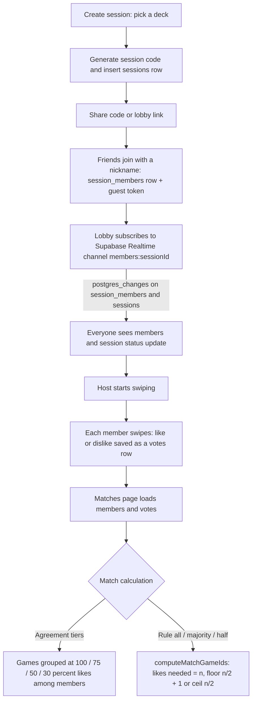

# Swipy

[](https://github.com/Destwood/Swipy/actions/workflows/ci.yml)
[](https://swipy-chi.vercel.app)

Swipy is a Tinder-style game/movie picker for solo play or with friends: swipe through a deck, collect matches, and decide what to play together.

**Live:** [https://swipy-chi.vercel.app](https://swipy-chi.vercel.app)

## Screenshots

| Deck | Lobby with friends | Matches |
| --- | --- | --- |
|  |  |  |

## Try it as a guest

No account is needed to swipe solo or to create or join a friend session: the deck, infinite mode and session lobby pages have no sign-in gate, and sessions use a per-device guest token. Google sign-in only adds account features such as synced decks, ignore list and swipe history.

## How realtime sessions work



## Design decisions

- **Supabase Realtime for the lobby.** The lobby listens to `postgres_changes` on `session_members` and `sessions` filtered by session id and refetches on any change, so joins and status changes appear without polling.
- **Guest sessions.** Sessions are created and joined through a Supabase client with persistence disabled; membership is a generated token stored on the device, so friends can join by code without signing up.
- **Match rules as a pure function.** `computeMatchGameIds` turns votes and member count into matches for the `all`, `majority` and `half` rules, and the agreement tiers in `match-results.ts` rank games by share of likes. Both are covered by unit tests. Sessions are currently created with the `all` rule.
- **Layered game cache.** Game details are read from a local library in `localStorage`, then from the `cached_games` table in Supabase (signed-in users only, `cached-games-db.ts`), and only then fetched from IGDB through `/api/games/by-ids` in chunks of 50.
- **`next build --webpack`.** SVG icons are imported as components through `@svgr/webpack`; the production build is pinned to webpack to keep that loader working on Vercel (see the changelog and the `next.config.ts` rules).

## Environment

Required variables (see `.env.example`):

- `NEXT_PUBLIC_SUPABASE_URL`
- `NEXT_PUBLIC_SUPABASE_ANON_KEY`
- `IGDB_CLIENT_ID`
- `IGDB_CLIENT_SECRET`
- `NEXT_PUBLIC_SITE_URL`

## Features

- Solo and infinite swipe modes with local swipe history
- Friend sessions: create/join by code, shared lobby link, realtime swiping
- Match rules (all / majority / half) and a shared matches view
- Game library and custom decks backed by the IGDB catalog
- Google OAuth sign-in via Supabase Auth, with guest sessions supported without an account

## Stack

- [Next.js](https://nextjs.org) 16 (App Router), React 19, TypeScript
- Tailwind CSS 4
- Supabase (Auth, Postgres, Realtime)
- IGDB API for the game catalog

## Getting Started

Copy `.env.example` to `.env.local` and fill in the required values, then run the dev server:

```bash
npm install
npm run dev
```

Open [http://localhost:3000](http://localhost:3000) with your browser to see the result.

## Scripts

```bash
npm run dev     # start the dev server
npm run build   # production build
npm run lint    # lint the project
npm run typecheck # type-check without emitting
npm test        # run unit tests (vitest)
```

## Deploy

Deployed on [Vercel](https://vercel.com); production tracks the `main` branch.
